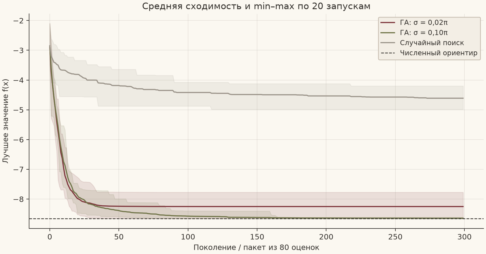
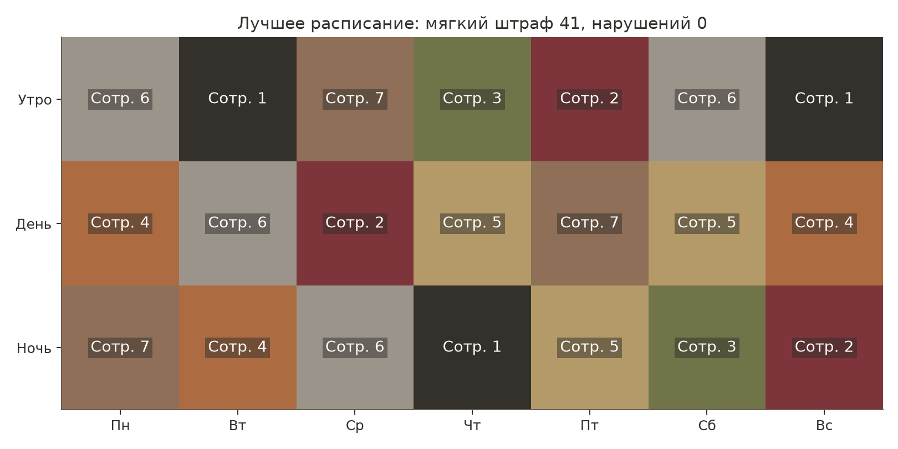

# Эволюционное программирование и генетические алгоритмы

Комплекс четырёх лабораторных работ НИЯУ МИФИ: собственные реализации алгоритмов, воспроизводимые эксперименты и отчёты с анализом результатов.

**Холодков Антон Евгеньевич · Б24-517 · 2026 год**
Номер по списку **N = 28**, индекс группы **Q = 1**, год **Y = 26**. Индивидуальный вариант:

```text
V = 1 + ((17 × 28 + 7 × 1 + 26) mod 20) = 10
Размерность непрерывных задач: d = 5 + (10 mod 6) = 9
```

Все четыре работы реализованы. В репозитории сохранены **560 запусков** и результаты **25 автоматических тестов**; состав и бюджеты проверяются в [протоколе проверки](verification.json). [Исходное задание](materials/assignment.docx) сохранено отдельно.

## Лабораторные работы

| Работа и реализация | Серия экспериментов | Отчёт | Результаты |
|---|---|---|---|
| [**ЛР1. Функция Михалевича**](lab1/README.md): вещественный ГА, два масштаба мутации, случайный поиск | 3 конфигурации × 20 seed; 24 000 оценок на запуск | [PDF](reports/lab1_report.pdf) | [Запуски](lab1/results/runs.csv) · [Сводка](lab1/results/summary.csv) |
| [**ЛР2. Расписание дежурств**](lab2/README.md): 21 смена, 7 сотрудников, штрафы и ремонт, два оператора мутации | 5 конфигураций × 20 seed; 6 000 оценок на запуск | [PDF](reports/lab2_report.pdf) | [Запуски](lab2/perrun.csv) · [Расписание](lab2/best_schedule.csv) |
| [**ЛР3. Архитектура классификатора**](lab3/README.md), трек B: структура сети, качество и сложность, внешний архив | 2 штрафа сложности × 20 seed; 240 обращений к fitness на запуск | [PDF](reports/lab3_report.pdf) | [Запуски](lab3/runs.csv) · [Три модели](lab3/representatives.csv) |
| [**ЛР4. Островной ГА**](lab4/README.md): панмиксия, изолированные острова, кольцо и полная связь на трёх функциях | 12 комбинаций × 30 seed; 30 000 оценок на запуск | [PDF](reports/lab4_report.pdf) | [Запуски](lab4/runs.csv) · [Парные сравнения](lab4/paired_comparison.csv) |

[Все отчёты одним PDF](all_reports.pdf) · [Параметры варианта](variant.json) · [Сборка отчётов и проверка](tools/README.md)

## Результаты в графиках

**ЛР1.** Средняя сходимость и диапазон min–max по 20 запускам при одинаковом бюджете. Генетический алгоритм сравнивается с равномерным случайным поиском.



**ЛР2.** Лучшее найденное допустимое расписание. Полные назначения и показатели ограничений приложены к работе.



## Установка

Требуется **Python 3.12**. Команды выполняются из корня репозитория:

```sh
python3.12 -m venv .venv
source .venv/bin/activate
python -m pip install -r requirements.txt
```

В Windows PowerShell окружение активируется командой `.venv\Scripts\Activate.ps1`. Версии NumPy и Matplotlib закреплены в [requirements.txt](requirements.txt). Готовые библиотеки оптимизации не используются: отбор, кроссоверы, мутации, ремонт, архив и миграция реализованы в исходном коде.

## Воспроизведение экспериментов

Полные серии можно запустить из корня репозитория с выводом в отдельные каталоги:

```sh
python lab1/main.py --output reproduced/lab1
python lab2/lab2.py experiment --runs 20 --budget 6000 --seed-start 0 --out reproduced/lab2
python lab3/lab3.py --runs 20 --budget 240 --output reproduced/lab3
python lab4/main.py --output reproduced/lab4
```

Для короткой демонстрации первой и второй работ:

```sh
python lab1/main.py --seed 102 --sigma 0.10
python lab2/lab2.py single --method repair --operator replace --seed 0 --budget 6000
```

У каждой работы есть собственный README с описанием операторов, файлов и команд. Конфигурации, seed, исходные данные, отдельные результаты и истории сходимости включены в репозиторий. Повторение seed воспроизводит численные результаты в той же программной среде; измеренное время зависит от компьютера и его загрузки.

## Проверка и отчёты

Дополнительные зависимости нужны для проверки PDF и повторной сборки отчётов:

```sh
python -m pip install -r requirements-dev.txt
python tools/verify_bundle.py
```

Проверка запускает все 25 тестов, сверяет 560 результатов, уникальность seed и точные бюджеты серий, проверяет комплектность четырёх PDF и обновляет `verification.json`.

```sh
python tools/build_reports.py
```

Сборщик использует сохранённые данные отчётов и рисунки. Он формирует четыре отдельных файла в `reports/` и общий `all_reports.pdf`. Подробности приведены в [инструкции инструментов](tools/README.md).

## Интерпретация и учебные условия

В отчётах приведены лучшие, средние и худшие результаты, медианы, выборочные стандартные отклонения, графики сходимости и ограничения исследования. Для классификатора train, validation и test разделены; test не участвует в выборе модели. Его бюджет учитывает обращения к fitness, включая попадания в кэш; число фактических обучений записано отдельно. В проектной работе дополнительно сохранены парные сравнения и bootstrap-интервалы.

Выводы относятся к указанным функциям и синтетическим экземплярам. Стохастический поиск не даёт гарантии глобального оптимума.

Для ЛР3 выбран **трек B**: методичка перечисляет оба трека без однозначного правила назначения. Для ЛР4 подготовлена [проектная заявка](lab4/proposal.txt); согласование темы преподавателем не подтверждено. Защита и приёмка остаются отдельными учебными процедурами.
